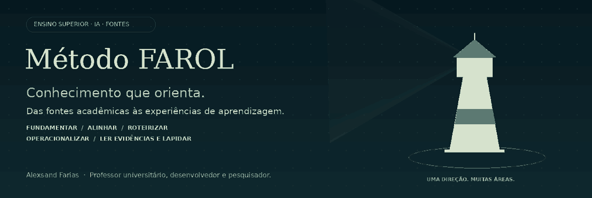

<p align="center"></p>

<p align="center">
<a href="LICENSE"></a>


</p>

<p align="center"><b><a href="https://alexsandsouza.github.io/Metodo_Farol/">Abrir site interativo ↗</a> &nbsp; · &nbsp; <a href="#comece-por-uma-aula">Começar</a> &nbsp; · &nbsp; <a href="prompts/README.md">Explorar prompts</a> &nbsp; · &nbsp; <a href="docs/02-usar-no-notebooklm.md">Usar no NotebookLM</a> &nbsp; · &nbsp; <a href="CONTRIBUTING.md">Contribuir</a></b></p>

# Uma direção para transformar suas fontes em aulas.

**O Método FAROL organiza o trabalho docente: das fontes acadêmicas às experiências de aprendizagem no Ensino Superior.** Reúna o plano de ensino, livros, artigos e documentos autorizados. Use o ciclo para planejar, produzir, aplicar e revisar aulas com apoio de IA e julgamento docente.

A proposta se adapta a **qualquer área do conhecimento**, respeitando métodos, evidências, linguagem e critérios da disciplina. O NotebookLM apoia a leitura e a síntese; a arquitetura pedagógica também pode ser usada com outros assistentes e editores.

> **Formação e Aprendizagem com Recursos Orientados por IA**  
> Concepção proposta: **Alexsand Farias** · Professor universitário, desenvolvedor e pesquisador.

## Comece por uma aula

| Passo | Ação | Abra |
|---|---|---|
| **01 · Contexto** | Informe tema, curso, período, duração e objetivos. | [Briefing](modelos/BRIEFING.txt) |
| **02 · Fontes** | Selecione materiais autorizados e registre sua procedência. | [Registro de fontes](modelos/REGISTRO_FONTES.csv) |
| **03 · Caderno** | Adicione fontes e orientações ao NotebookLM. | [Guia passo a passo](docs/02-usar-no-notebooklm.md) |
| **04 · Primeiro comando** | Identifique conceitos, evidências e lacunas. | [P01 — Diagnosticar o acervo](prompts/P01-diagnosticar-o-acervo.md) |
| **05 · Revisão** | Confira o conteúdo e a experiência antes de publicar. | [Checklist docente](modelos/CHECKLIST_PUBLICACAO.md) |

**Não é preciso programar para o uso básico.** Baixe o projeto em **Code → Download ZIP**, extraia a pasta e utilize os arquivos. O ZIP não é executado pelo NotebookLM.

## O ciclo FAROL

| Etapa | Pergunta que orienta | Entrega |
|---|---|---|
| **F · Fundamentar** | O que ensinar e em quais fontes confiar? | Contexto, mapa de evidências e lacunas |
| **A · Alinhar** | Como objetivos, prática e avaliação se encontram? | Matriz de alinhamento |
| **R · Roteirizar** | Como mediar a aprendizagem ao longo da aula? | Plano, exemplos, perguntas e sequência |
| **O · Operacionalizar** | Quais materiais tornam o plano aplicável? | Recursos, atividades e versões revisadas |
| **L · Ler evidências e lapidar** | O que os estudantes demonstraram e o que melhorar? | Feedback e registro de melhorias |

A revisão atravessa todas as etapas. Não há duração obrigatória, formato único de aula ou produção de todos os recursos em toda aplicação.

## Escolha seu ponto de partida

<table>
<tr><td width="50%"><h3>Planejar com intenção</h3><p>Relacione objetivos, fontes e evidências de aprendizagem.</p><a href="docs/01-fundamentos.md">Conhecer os fundamentos →</a></td><td width="50%"><h3>Produzir com critério</h3><p>Use comandos completos para criar materiais e atividades.</p><a href="prompts/README.md">Explorar os 12 prompts →</a></td></tr>
<tr><td><h3>Adaptar à sua disciplina</h3><p>Combine perfis por área e detalhe métodos e critérios do campo.</p><a href="perfis/README.md">Explorar os perfis →</a></td><td><h3>Melhorar com evidências</h3><p>Documente a aplicação e compartilhe o que aprendeu.</p><a href="docs/06-validar-e-melhorar.md">Planejar um piloto →</a></td></tr>
</table>

## Uma arquitetura reutilizável

| Recurso | Para que serve |
|---|---|
| [8 módulos pedagógicos](modulos/README.md) | Curadoria, alinhamento, roteiro, recursos, atividades, avaliação, acessibilidade e revisão |
| [12 prompts completos](prompts/README.md) | Do diagnóstico do acervo à melhoria após a aula |
| [Perfis por área](perfis/README.md) | Seis pontos de partida adaptáveis e orientação para novos campos |
| [Modelos preenchíveis](modelos/README.md) | Briefing, perfil disciplinar, matriz, fontes, checklist e melhorias |
| [Exemplos de aplicação](exemplos/README.md) | Percursos ilustrativos para tornar o fluxo concreto |
| [Skill FAROL](skills/README.md) | Orquestração para assistentes compatíveis com esse formato |
| [Página interativa — acessar](https://alexsandsouza.github.io/Metodo_Farol/) | Apresentação visual, explorador de recursos e gerador de prompt inicial |

### Seu primeiro pedido

```text
Use as orientações FAROL, meu briefing e o perfil disciplinar.
Use as fontes acadêmicas selecionadas para diagnosticar o acervo da aula.
Relacione conceitos aos trechos que os sustentam e indique lacunas.
Depois, proponha objetivos e uma matriz de atividades e avaliação.
Não invente conteúdo de fontes ausentes. Identifique exemplos fictícios.
```

**No NotebookLM, os módulos são textos de orientação acionados por prompts.** Carregar `SKILL.md` como fonte não instala funcionalidades. Em outros assistentes, a instalação da skill depende da plataforma. Confira citações e revise os arquivos finais.

<details>
<summary><b>O que o FAROL pode ajudar a preparar?</b></summary>

Roteiros de aula, storyboards de slides, textos de estudo, atividades, avaliações, rubricas, roteiros de áudio e vídeo, mapas e textos de publicação. Arquivos prontos, imagens e animações dependem das ferramentas de produção disponíveis. Um storyboard não é um PPTX finalizado.

</details>

<details>
<summary><b>Como usar em áreas diferentes?</b></summary>

Adapte objeto, tipo de evidência, métodos, convenções e critérios. Uma demonstração matemática, uma interpretação histórica e uma produção artística revelam aprendizagem de formas distintas. Combine perfis para disciplinas interdisciplinares. [Veja exemplos](exemplos/README.md).

</details>

<details>
<summary><b>O método já foi validado?</b></summary>

A estrutura da skill foi verificada e houve uma aplicação simulada em Artes e História. Ainda não há validação empírica em turmas nem teste de execução em conta NotebookLM documentado neste projeto. Os exemplos são propostas de planejamento. [Conheça o protocolo de piloto](docs/06-validar-e-melhorar.md).

</details>

## Ajude a orientar o próximo passo

Não é preciso contribuir com código. Você pode revisar um guia, apontar uma barreira de acesso, propor um perfil ou relatar uma aplicação com evidências anonimizadas.

| Quero… | Caminho |
|---|---|
| Relatar um problema | [Abrir relato](https://github.com/alexsandsouza/Metodo_Farol/issues/new?template=problema.yml) |
| Sugerir uma melhoria | [Enviar uma ideia](https://github.com/alexsandsouza/Metodo_Farol/issues/new?template=melhoria.yml) |
| Compartilhar uma aplicação | [Registrar experiência](https://github.com/alexsandsouza/Metodo_Farol/issues/new?template=aplicacao.yml) |
| Alterar materiais | [Ler como contribuir](CONTRIBUTING.md) e abrir um pull request |

Compartilhe contexto, fontes e limites. Preserve dados de estudantes e as condições de uso do acervo. Se o projeto for útil, deixe uma estrela para encontrá-lo novamente e ajudar outras pessoas a descobri-lo.

## Autoria, licença e reconhecimento

**Alexsand Farias** · Professor universitário, desenvolvedor e pesquisador.  
[LinkedIn](https://www.linkedin.com/in/alexsandfarias) · [GitHub](https://github.com/alexsandsouza)

Os materiais originais são disponibilizados sob a [licença MIT](LICENSE). **Copyright (c) 2026 Alexsander Farias de Souza.** Veja [escopo dos direitos](DIREITOS.md).

Inspiração arquitetural: [N.A.G. — NotebookLM para Concursos](https://github.com/gilsonnogueira/notebooklm-para-concursos), de Gilson Nogueira. O projeto de referência reconhece [book-to-skill](https://github.com/virgiliojr94/book-to-skill), de Virgílio Jr. [Créditos e fontes](CREDITOS.md).

<p align="center"><sub>Uma direção. Muitas áreas. Revisão docente em cada etapa.</sub></p>
