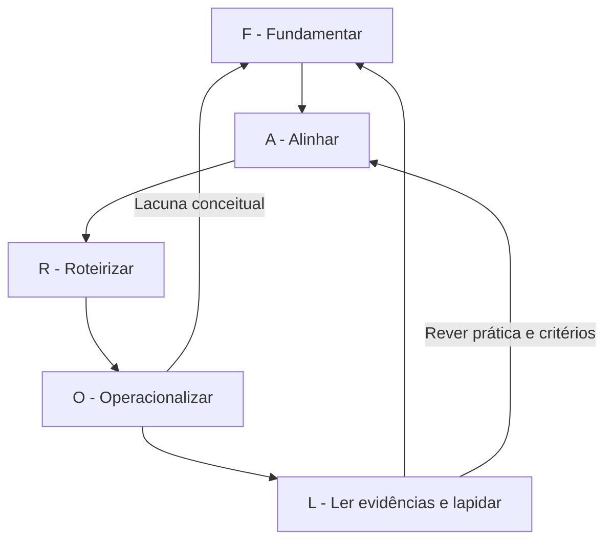

# Modelo de engenharia de materiais didáticos

## O que será construído?
Uma aula é um sistema de decisões: o estudante precisa realizar algo, encontrar apoio para aprender e demonstrar o que consegue fazer. O material pode ser um texto, uma apresentação, um caso, um experimento, uma produção artística ou uma combinação. A quantidade de arquivos não é o indicador central de qualidade.

No FAROL, “engenharia” indica um processo explícito e revisável. Especificação, rastreabilidade, prototipagem e verificação são escolhas de organização do trabalho. O modelo é pedagógico e não deve ser confundido com a graduação em Engenharia de Materiais.

## As cinco etapas e seus critérios de passagem

| Etapa | Entrada | Procedimento | Saída mínima | Antes de avançar |
|---|---|---|---|---|
| F - Fundamentar | Plano, briefing, fontes autorizadas | Delimitar o assunto; conferir versões; mapear suporte e lacunas | Briefing e mapa de evidências | Há suporte para os conceitos centrais? |
| A - Alinhar | Mapa e contexto da turma | Relacionar objetivo, conteúdo, prática e avaliação | Matriz de alinhamento | Cada objetivo possui prática e evidência? |
| R - Roteirizar | Matriz revisada | Distribuir tempos; preparar explicações, perguntas e apoio | Roteiro da aula | A sequência é executável no tempo disponível? |
| O - Operacionalizar | Roteiro e formatos escolhidos | Produzir, conferir e preparar os materiais | Kit revisado do aluno e do docente | Conteúdo, acesso e gabarito foram conferidos? |
| L - Ler evidências e lapidar | Produções reais e critérios | Interpretar resultados; devolver feedback; registrar mudanças | Registro de revisão | A mudança proposta responde a uma evidência? |

Uma pendência pode exigir retorno à etapa anterior. A aprovação é uma decisão docente, não um certificado emitido pelo assistente.

## Fluxo com retorno

## Contrato de cada material
Antes de pedir um produto à IA, escreva: destinatário; objetivo atendido; fonte de conteúdo; função pedagógica; extensão; formato; barreiras de acesso; critério de aprovação. Exemplo autoral: “Uma ficha de uma página para comparar duas interpretações de um documento histórico, com trechos autorizados, contextualização, espaço de justificativa e versão textual acessível”.

## O papel de cada referencial

| Componente | Decisão que apoia | Aplicação no FAROL |
|---|---|---|
| Alinhamento construtivo | A coerência entre resultado, atividade e avaliação | Matriz em A; conferência em O |
| Bloom revisada | O processo cognitivo e o conhecimento mobilizado | Objetivos e evidências em A |
| Andragogia | Relevância, experiência, autonomia e apoio | Briefing em F; escolhas em R |
| Provocação socrática | Clareza, pressupostos, evidências e implicações | Perguntas e mediação em R |
| PROMPTIA | A intencionalidade do pedido e da experiência | Especificação em A, R e O |
| Acessibilidade | Barreiras de compreensão, participação e uso | Revisão em todo o ciclo |

Essa articulação é uma proposta de desenho do FAROL. As referências sustentam componentes, sem comprovar a eficácia da combinação. Consulte a [base comentada](17-referencias-e-autoria.md).

## Registro de versão
Nomeie a aula por disciplina, tema e revisão, por exemplo `Historia_Fontes_v01`. Registre data, fontes usadas, autor da revisão e pendências. Após aplicação, preserve a versão utilizada e registre a mudança em uma nova versão. Evite sobrescrever a evidência do que foi efetivamente entregue.
